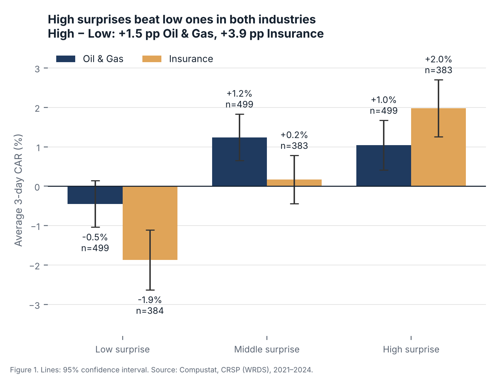
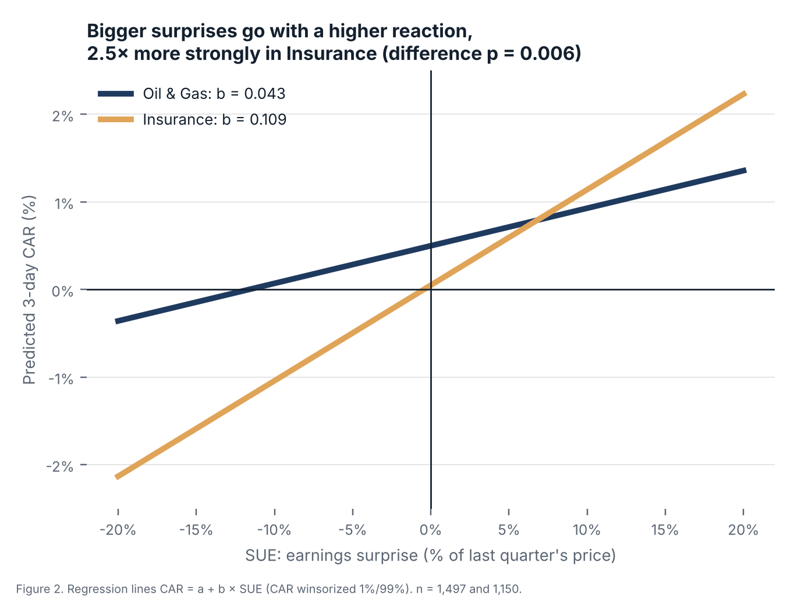

# Do Earnings Surprises Move ConocoPhillips' Stock?

**Hogwarts Consulting · Project 3 · BAN4550**
**Author:** Ojal Rayamajhi
**Client:** ConocoPhillips · **Industry:** Oil & Gas Extraction (SIC 13) · **Comparison industry:** Insurance Carriers (SIC 63)

## The question

Do better-than-expected earnings lead to a higher stock reaction in the three days around the announcement, and is the reaction the same in a peer industry?

- **Earnings surprise (SUE):** this quarter's EPS minus EPS in the same quarter last year, divided by last quarter's share price.
- **Stock reaction (CAR):** the stock's daily return minus the market's daily return, added up over trading days −1, 0 and +1 around the announcement.
- **Groups:** all announcements ranked by SUE and split into three equal groups: Low, Middle, High.

## Main result (Figure 1)



| SUE group | Oil & Gas: average CAR | Insurance: average CAR |
|---|---|---|
| Low | −0.45% (n = 499) | −1.9% (n = 384) |
| Middle | +1.24% (n = 499) | +0.2% (n = 383) |
| High | +1.04% (n = 499) | +2.0% (n = 383) |

In both industries, high-surprise announcements earn more than low-surprise ones over three days. The gap (High minus Low) is **1.49 percentage points in Oil & Gas** and **3.86 percentage points in Insurance**.

## Is the difference real? (t-test, regression, Figure 2)



| | Oil & Gas | Insurance |
|---|---|---|
| High − Low (t-test) | 1.49 pp, t = 3.39, p = 0.0007 | 3.86 pp, t = 7.38, p < 0.0001 |
| Slope b (CAR = a + b × SUE) | 0.0429, p = 0.0007 | 0.1091, p < 0.0001 |
| R² | 0.008 | 0.024 |
| Announcements (companies) | 1,497 (130) | 1,150 (88) |

- **t-test:** if there were really no difference between High and Low, a gap this large would appear by luck less than 0.1% of the time in both industries.
- **Regression:** when SUE is 0.01 higher (1% of the share price), the 3-day CAR is on average 0.04 percentage points higher in Oil & Gas and 0.11 points higher in Insurance.
- **Difference between the industries:** the Insurance slope is about 2.5 times steeper, and this difference is unlikely to be luck (p = 0.006).
- **R² is small:** the surprise explains under 1% of the 3-day reaction in Oil & Gas.
- **Robustness:** CAR is winsorized at 1%/99%. b is about the same without winsorizing (0.0419) and with year fixed effects and a loss variable (0.043, 0.044, 0.033).

## Why the industries differ (Figure 3)


**Reason checked:** Oil & Gas profits swing with oil prices, so more quarters end in a loss, and investors may trust one quarter's earnings less. In Oil & Gas, loss quarters had a 1.1 percentage point lower CAR (p < 0.05).

**Check:** the share of loss quarters in each industry, and the slope b using profit quarters only.

**Result:** [Copy the sentence the notebook prints: supported / not supported, with the loss shares and the two slopes.]

## Advice for the client

- **Business implication:** beating expectations is rewarded, but only a little in Oil & Gas: about 1.5 percentage points over three days, less than half of what insurers get. ConocoPhillips should explain what drives each quarter (oil prices, production) rather than manage EPS to beat a number.
- **Limitation:** the surprise explains under 1% of the 3-day move (R² = 0.008), and the sample covers only 2021–2024, years of unusual oil prices.
- **Next questions:**
  - Predictive: does the week's oil price change help predict ConocoPhillips' 3-day reaction? (Needs daily WTI oil prices.)
  - Prescriptive: should ConocoPhillips give quarterly earnings guidance to keep surprises small? (Needs analyst forecasts and guidance history.)

## Data sources (described, not shared)

All data comes from WRDS and is not included in this repository.

| Source | Table | What we use |
|---|---|---|
| Compustat | `comp.fundq` | Quarterly EPS (`epspxq`), price (`prccq`), announcement date (`rdq`) |
| CRSP | `crsp.dsf` | Daily stock returns |
| CRSP | `crsp.dsi` | Daily value-weighted market return (`vwretd`) |
| Course link file | `ccm_link.csv` | Links Compustat `gvkey` to CRSP `permno`, with link dates |

Sample: announcements from January 2021 to December 2024.

## Merge map

| Step | Tables | Keys | How dates were matched |
|---|---|---|---|
| Merge 1 | `comp.fundq` + `ccm_link.csv` | `gvkey` → `permno` | Link valid on the quarter end: `linkdt ≤ datadate ≤ linkenddt` |
| Merge 2 | `comp.fundq` with itself | `gvkey` + `quarter_num` | EPS from 4 quarters earlier, price from 1 quarter earlier |
| Merge 3 | `crsp.dsf` + `crsp.dsi` | `permno` + `date`; `date` | Daily abnormal return = stock return − market return |
| Event window | trading-day calendar | `event_id` | Day 0 = first trading day on or after `rdq`; days −1, 0, +1 |

**Rules:** (1) `rdq` known; (2) `rdq` between Jan 2021 and Dec 2024; (3) SUE can be computed; (4) last quarter's price ≥ $5; (5) |SUE| ≤ 1; (6) all 3 daily abnormal returns found.

**Sample construction:** Oil & Gas 3,285 company-quarters → 1,497 announcements (130 companies). Insurance 1,959 → 1,150 (88 companies).

## Changes since Project 2

- **What was wrong:** the lags used `groupby("gvkey").shift(4)` and `shift(1)`. These take the row 4 (or 1) places above, not the quarter 4 (or 1) quarters earlier. If a company had a missing quarter, the lag came from the wrong quarter, with no error.
- **How I fixed it:** I made `quarter_num = fyearq × 4 + fqtr`, added 4 (for EPS) and 1 (for price) to it in a copy of the table, and merged the copy back on `gvkey` and `quarter_num`. Now a missing quarter gives a missing lag, and Rule 3 removes that row.
- **How the results changed:** [Project 2 numbers → now: Rule 3 keeps 1,963 rows, final sample 1,497 announcements; compare your old High − Low gap and b with the new ones.]

## Repository structure

```
notebooks/   Project3_final.ipynb (runs top to bottom on WRDS JupyterHub with the link file uploaded)
figures/     figure1_groups_both_industries.png, figure2_scatter_both_industries.png,
             figure3_loss_share.png, figure_optional_car_days.png
docs/        Last_First_Project3.pdf (slides), Last_First_Project3_notebook.pdf
```

## Where the code came from

- Course materials: BAN4550 in-class notebooks (Assignment 8, week 12) and my Project 2 notebook.
- AI conversations (one line per conversation):

| Claude | [(https://claude.ai/)] | checking the Project 3 checklist; helping with Part 7 (Figures 1–3 for both industries, plain-word results for both industries, the optional year fixed effects and loss models for Insurance, the optional day −5 to +5 chart); fixing notebook text, simplifying the lag code; drafting this README |

## Author

Ojal Rayamajhi · BAN4550 · Clark University
